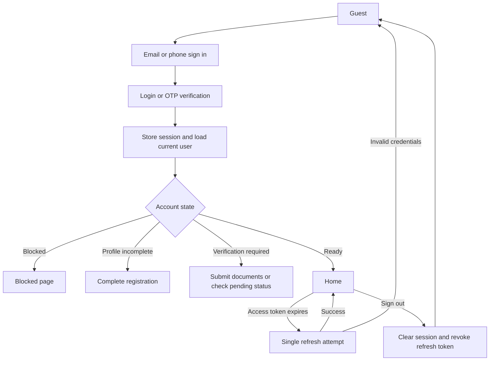
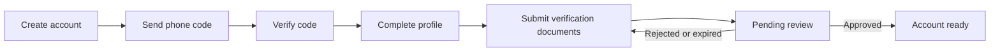

# Authentication and onboarding integration

## Current architecture

The application uses Vite, React 18, Fuse, MUI, React Router 6, Redux Toolkit/RTK Query, Axios, react-hook-form, Zod, and i18next. `src/app/configs/apiConfig.ts` creates the shared Axios connection from `VITE_BASE_URL`; `src/app/store/apiService.ts` adapts it to RTK Query. `JwtAuthProvider` owns the current user and session, while `session.ts` supplies bearer headers and single-flight refresh. `FuseAuthorization` and `accountDestination` gate guest, blocked, unregistered, and verification-required routes. Authentication pages share `AuthLayout`, `AuthForm`, fields, localized strings, and the product logo. There is already email/password and phone OTP sign-in, OTP sign-up, password recovery, profile registration, and document verification. This work extends those paths rather than introducing a second auth stack.

## Verified API inventory

Source: [Ashamco OpenAPI 3.1 Swagger page](https://api.v1.dev.e5hh6.ashamcoexpress.com/docs), inspected 2026-11-03. The schema is embedded in `/docs`; `/openapi.json` returned 404. `userAuthenticated` means a bearer JWT. Error responses use `{statusCode, type, message, errors?}` when specified. `422 E_INVALID_BODY` applies to malformed documented request bodies; other codes appear below. Success bodies marked *unspecified* have no schema in Swagger and need fixture or backend verification.

| Method and path | Body and documented validation | Success | Auth; documented errors |
| --- | --- | --- | --- |
| POST `/v1/auth-sessions/login` | `password` required; optional `email` (email format) or `phone` | 201 `{accessToken, accessTokenExpiresAt, refreshToken, refreshTokenExpiresAt, user}`; user has required `id` and optional identity, address, role, registration/verification flags | Public; 422 |
| POST `/v1/auth-sessions/refresh` | `refreshToken` required, nonempty | 201 `{accessToken, accessTokenExpiresAt}` | Public; 400 invalid credentials, 422 |
| POST `/v1/auth-sessions/destroy` | `refreshToken` required, nonempty | 204 empty | Bearer; 401, 403, 422 |
| POST `/v1/users` | Optional `email` (email format), names, password, phones, company/tax/referral data and address; address geographic IDs must be 24-character hex; `affiliateCode` nonempty if supplied; additional properties disallowed | 201, body unspecified | Public; 422 |
| GET `/v1/users/me` | None | 200, body unspecified | Bearer; 401, 403 |
| PATCH `/v1/users/me` | Optional email, names, phone, company, tax number and address; geographic IDs must be 24-character hex; additional properties disallowed | 200, body unspecified | Bearer; 401, 403, 422 |
| POST `/v1/users/forgot-password` | `email` required, email format; additional properties disallowed | Unspecified | Public; 422 |
| POST `/v1/users/reset-password` | `email`, `password`, `confirmPassword`, `token` required; additional properties disallowed | Unspecified | Public; 422 |
| POST `/v1/users/send-codes` | `phone` and `type` required; type is `link`, `signIn`, or `signUp`; optional email | Unspecified | Public; 404 user missing, 422 |
| POST `/v1/users/verify-codes` | `phone`, `code`, numeric `msegatId` required; optional nonempty affiliate code | 200, body unspecified | Public; 404 user missing, 422 |
| POST `/v1/users/send-phone-code` | `phone` required | Unspecified | Bearer; 401, 403, 422 |
| POST `/v1/users/send-email-otp` | `email` required | Unspecified | Bearer; 401, 403, 404 user missing, 422 |
| POST `/v1/users/verify-email-otp` | `email` and `code` required | 200, body unspecified | Bearer; 401, 403, 404 user missing, 422 |
| POST `/v1/users/apply-affiliate-code` | `affiliateCode` required | 200, body unspecified | Bearer; 401, 403, 404, 422 |
| GET/POST `/v1/requests` | POST requires `type`; the existing verification UI sends current `userId`, `type: verification`, `status: pending`, and document fields | Success bodies unspecified | Bearer; 401, 403, 422 |

Dependencies: login or successful OTP verification establishes a session; `/users/me` supplies route state; authenticated contact verification and request submission require that session. Refresh replaces an expired access token; destroy revokes a refresh token. No separate onboarding-progress/completion endpoint exists in the schema. The direct registration endpoint does not document how it relates to OTP sign-up; do not switch the working flow without backend acceptance evidence.

## Session and onboarding design

Keep one Axios connection, one JWT provider, and one route gate. Add typed transport contracts beside the auth service, while retaining the canonical `User` entity. Keep access and refresh tokens in the existing browser storage for compatibility until the backend offers an HttpOnly cookie flow. Never log credentials or tokens. On sign-out, capture the refresh token, clear the local session and RTK cache synchronously, then attempt best-effort remote destroy. Do not retry refresh for the destroy call. On protected 401, refresh once across concurrent requests; clear session when refresh credentials are invalid. Do not reinterpret 403 as an expired session.

## Screens and data flow

Use the existing blue gradient, logo, MUI card and fields, language switcher, and English/Arabic translations. On small screens keep the card inside the viewport; show a compact step indicator for registration and verification. Preserve clear labels, keyboard focus, field-level errors, disabled duplicate submits, retry actions, and visible loading/success states.

| Screen | Requirements |
| --- | --- |
| Sign in | Email/password, phone sign-in link, recovery and registration links; report credential errors without exposing server internals. |
| Sign up and OTP | Existing phone challenge, countdown/resend, profile fields, terms, and optional referral code; retain drafts on send/verify failures. |
| Forgot/reset password | Email request confirmation; reject incomplete reset links; validate password confirmation; show completion or sign-in path if automatic login fails. |
| Profile registration | Populate from `/users/me`; edit permitted fields; preserve drafts through network errors; route by returned `isRegistered`. |
| Account verification | Existing company/small-store documents, upload progress, pending status and retry; never allow a duplicate submission after confirmed creation. |
| Completion | Use the existing home destination after the user state confirms registration and approval; no invented completion API. |

RTK Query remains for places and verification requests; the JWT provider continues to own login/profile mutations because session changes need ordered cleanup. Map documented `422` field errors to form fields where possible and use localized general errors for network or undocumented responses. Preserve unsaved fields on refetch and failed writes. Route protection derives from canonical `User` fields, never a separate client-only onboarding flag.

## Implementation order and verification

1. Record this contract and configure the supplied dev host in `.env.development` via `VITE_BASE_URL`; keep the existing production default for deployments that have not opted in.
2. Add typed auth transport contracts; integrate best-effort remote logout; harden the existing registration, refresh, and recovery failure boundaries without changing unverified request shapes.
3. Polish the existing responsive auth screens and localized step/status guidance; add only backend-supported screens.
4. Add focused regression tests for logout, refresh races, partial registration, form failures, route gates, and verification flow. Run active typecheck, lint for touched files, build, and browser checks. Distinguish fixture results from live backend acceptance.

Risks and open questions: Swagger omits successful OTP, recovery, `/users/me`, and request response schemas. Its security-scheme prose mentions a stale `/sessions/native` path, while the path inventory documents `/v1/auth-sessions/login`. The current OTP sign-up sends profile fields to PATCH `/users/me`, including a password, although that PATCH schema excludes password; verify intended account creation and password handling with a safe test account before changing this production path. Confirm whether logout accepts a bearer token after local UI state is cleared and whether CORS permits the configured dev host. The supplied host must not be baked into unrelated environments.

## Implementation progress and live acceptance gate

The foundation now has typed login, refresh, reset and verification-submission contracts; development API configuration; remote logout; localized onboarding progress; retryable session startup; profile-save retry after successful OTP without another verification call; and password-reset completion independent of automatic sign-in. Auth regression and fixture browser checks cover those failure paths. The browser fixtures are not evidence of live backend compatibility. A dedicated development account and functioning OTP delivery are required to confirm the undocumented success shapes and the password/registration contract before changing the sign-up transport or declaring end-to-end acceptance.
